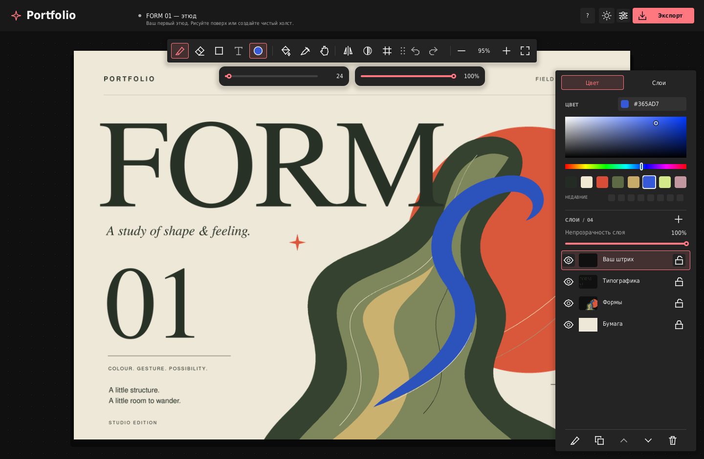

# Portfolio

Студия 2D-рисования для Windows: кисти, слои и панели, которые можно расположить под себя.

**Windows 10 (1703+) / 11 · x64 · Версия 0.1.0**

[**Скачать Portfolio.exe**](Portfolio.exe?raw=1) · [Начало работы](START_HERE_RU.md)



| Настройки кисти | Работа со слоями |
| :---: | :---: |
| [](previews/Portfolio_Brush_Properties_Basic.png) | [](previews/Portfolio_Layers.png) |

*Программные превью интерфейса. Отрисовка шрифтов в Windows может отличаться.*

## Возможности

- В каталогах по 14 кистей и ластиков. «Щетина», «Пунктирная», «Сухая кисть» и «Двойное перо» дают разные штрихи. Масштаб фактуры и разброс непрозрачности сохраняются отдельно для каждого варианта.
- Нажмите **T**, выберите один из десяти текстовых стилей и печатайте прямо на холсте. Нажмите название шрифта под каталогом, введите часть названия или прокрутите список из 10 гарнитур. Выбор сразу применяется к надписи. [Список шрифтов](previews/Portfolio_Text_Fonts.png)
- Шестерёнка открывает свойства текста. Слева выберите «Шрифт», «Эффекты» или «3D», справа настройте начертание, подчёркивание, зачёркивание, направление тени и объём. Образец над категориями обновляется сразу. [Посмотреть панель](previews/Portfolio_Text_Properties.png)
- Общий цвет кисти и текста задаётся в верхней панели. Нажмите цветной кружок, выберите оттенок на кольце и настройте насыщенность и яркость внутри. [Цветовой круг](previews/Portfolio_Color_Disc.png)
- Восемь фигур, в том числе треугольник, ромб, пятиугольник, шестиугольник и звезда. Для семи замкнутых фигур можно отдельно задать непрозрачность заливки.
- Слои, отмена и повтор, зеркальное рисование, масштабирование холста.
- Импорт PNG/JPEG/BMP, экспорт PNG, сохранение проектов и резервное восстановление.
- Перемещаемые панели, две темы, шесть языков и настройка шрифтов.

## Быстрый запуск

Скачайте **Portfolio.exe** по ссылке выше и запустите. Rust и установка шрифтов не нужны.

При запуске открыт этюд FORM 01 — можно сразу рисовать. **Ctrl+N** создаёт новый холст, **Ctrl+S** сохраняет проект, **Ctrl+Shift+E** экспортирует PNG.

## Сборка из исходников

На Windows нужны Rust (`x86_64-pc-windows-msvc`), MSVC Build Tools и Windows SDK. Выполните из корня проекта:

```powershell
cargo run --release
```

[Полное руководство](docs/USER_GUIDE_RU.md) · [Проверки и ограничения](docs/VALIDATION.md) · [Лицензия MIT](LICENSE)
